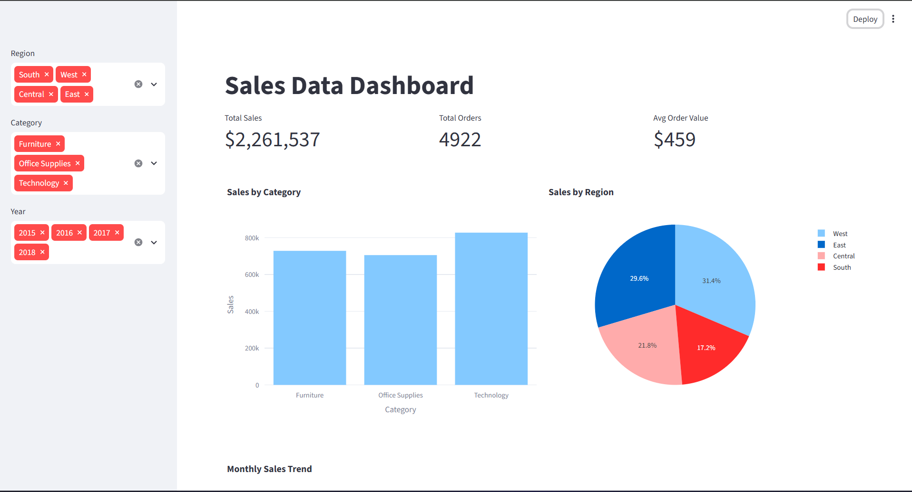

# Sales Data Dashboard

Interactive dashboard built with Python, Pandas, Plotly and Streamlit on the Superstore Sales dataset.

## Features
- Data cleaning (duplicates, date parsing, Year/Month columns)
- Filters: Region, Category, Year
- KPIs: Total Sales, Total Orders, Avg Order Value
- Charts: Sales by Category, Sales by Region, Monthly Trend, Top 10 Products

## Run
pip install pandas plotly streamlit
streamlit run app.py

